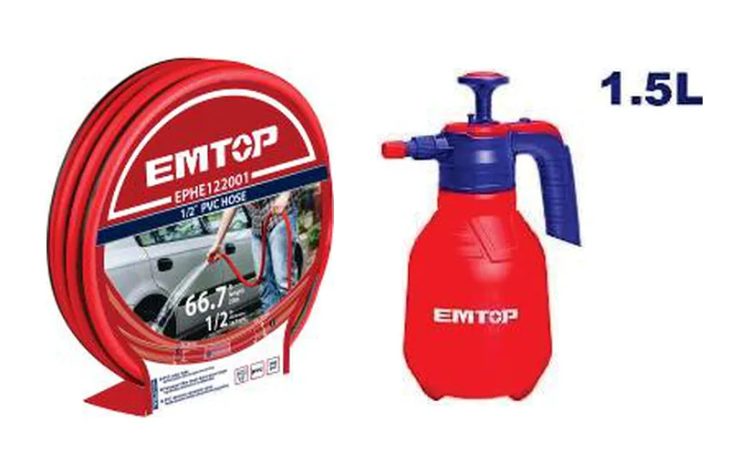

# Uldem · Landing

Página estática de Uldem (distribuidora mayorista de ferretería y corralón, Olavarría).
Presenta la empresa, muestra los rubros y deriva todas las consultas a WhatsApp.
**No muestra precios**: todo se consulta por WhatsApp.

Es HTML + CSS + JS puro: no hay nada que instalar ni compilar. Para verla, abrí `index.html` con doble clic.

## Estructura

```
uldem-landing/
├─ index.html          Todo el contenido y los textos
├─ marca.html          Página de cada marca (marca.html?marca=gladiator, ?marca=emtop, ...)
├─ rubro.html          Página de cada rubro (rubro.html?rubro=herramientas-electricas, ...)
├─ css/styles.css      Diseño (colores, tipografías, tamaños)
├─ js/main.js          Número de WhatsApp, armado de los links y funcionamiento del catálogo
├─ js/catalogo.js      Rubros y productos del catálogo (ver "Cambiar o agregar productos")
├─ assets/
│  ├─ logo/            uldem-logo.webp (el que usa la página), uldem-logo.png, favicon.png, og-image.jpg
│  ├─ products/        Una foto .webp por rubro (portadas)
│  │  ├─ catalogo/     Fotos livianas de cada producto, una carpeta por rubro (las que usa la página)
│  │  └─ Imagenes/     Fotos originales en alta (pesadas). NO se publican ni se suben a Git
│  └─ brands/          (vacía) logos de marcas, si se consiguen
├─ source/             Archivos originales. NO SUBIR AL HOSTING (ver abajo)
├─ qa/                 Capturas de revisión en celular, tablet y escritorio. No hace falta subirla
├─ armar-publicacion.bat   Genera la carpeta publicar/ lista para subir (ver "Publicar")
├─ publicar/           La crea el script: copia del sitio sin source/ ni qa/
├─ .gitignore          Excluye source/, qa/ y publicar/ de Git
└─ README.md
```

## Cambiar el número de WhatsApp

Se cambia en un solo lugar: las primeras líneas de `js/main.js`.

```js
const WHATSAPP_NUMBER = "5492284588656"; // el que usan los links
const WHATSAPP_DISPLAY = "2284-588656";  // el que se lee en el footer
```

`WHATSAPP_NUMBER` va en formato internacional, sin `+`, espacios ni guiones:
`54` (Argentina) + `9` (celular) + código de área sin el 0 + número sin el 15.

Todos los botones de WhatsApp de la página toman el número de ahí.

## Cambiar los mensajes de WhatsApp

Cada botón tiene en `index.html` un atributo `data-wa` con el mensaje que aparece ya escrito al abrir el chat:

```html
<a class="card__link" data-wa="Hola, quiero consultar por Jardinería">Consultar precios →</a>
```

Editá el texto entre comillas. No hace falta codificar nada: de eso se encarga `main.js`.

El botón flotante (el círculo rojo de abajo a la derecha) es el `<a class="fab" …>` del final de `index.html`.
Se oculta solo mientras hay otro botón grande de WhatsApp en pantalla, para no tapar contenido.

## Cambiar textos

Todos los textos están en `index.html`, separados por comentarios (`<!-- ===== 2. HERO ===== -->`, etc.).
Abrí el archivo con cualquier editor (Bloc de notas, VS Code), cambiá el texto entre las etiquetas y guardá.

### Pendientes marcados con [COMPLETAR]

Queda un solo pendiente, resaltado en amarillo al final del párrafo principal de **Quiénes somos**:
hace cuántos años trabajan y a quiénes abastecen.

Buscá `[COMPLETAR` en `index.html` y vas a encontrar esto:

```html
<mark>[COMPLETAR: hace cuántos años trabajan y a quiénes abastecen]</mark>
```

Reemplazá toda esa línea por el texto real. Hay que borrar también la etiqueta `<mark>` que lo envuelve
(la apertura `<mark>` y el cierre `</mark>`); si queda, el texto sigue saliendo resaltado en amarillo.

## Cambiar o agregar productos

La sección Productos muestra los 14 **rubros**. Cada uno abre su propia página (`rubro.html?rubro=<id del rubro>`, por ejemplo `rubro.html?rubro=jardineria`),
igual que las marcas: encabezado del rubro, botón **Volver** (o el "atrás" del navegador) y todos sus productos juntos,
ordenados con un título por sección, sin filtros:

- Herramientas eléctricas y Herramientas a batería: **Línea industrial** y **Línea profesional**.
- Insumos de ferretería: Discos, Soldadura, Guantes, Cintas y precintos, Cepillos y mechas.
- Los rubros sin grupos muestran sus productos directamente.
- Ningún producto muestra precio. Cada uno tiene:
  - **Agregar**: lo suma a "tu consulta". Abajo aparece una barra con la cantidad y el botón
    *Consultar por WhatsApp*, que abre el chat con la lista de productos ya escrita. Tocando la cantidad se ve
    la lista y se pueden quitar productos. La consulta queda guardada en ese navegador si se recarga la página.
  - **Ícono de WhatsApp**: consulta solo por ese producto.
- "Consultar todo el rubro" pregunta por el rubro entero.

Todo se carga desde `js/catalogo.js`. Cada producto es una línea así:

```js
{ nombre: "Amoladoras", foto: "amoladoras.jpg" },
```

- **Agregar un producto**: copiá una línea dentro del rubro (o de la línea) que corresponda y cambiá `nombre` y `foto`.
- **Sacar un producto**: borrá su línea.
- **Agregar un rubro**: copiá un bloque `{ id: ..., nombre: ..., portada: ..., carpeta: ..., productos: [...] }` entero.
  Si el rubro se divide en líneas o tipos, usá `grupos` en lugar de `productos` (copiá el de Herramientas eléctricas).
  Con `todos: true` aparece además el botón "Todos" (como en Insumos de ferretería).

### Productos por marca

En la sección **Marcas**, cada tarjeta (Gladiator, NEO, Energy, EMTOP, OBRA, BOLTZ y Luxom) abre una página aparte
(`marca.html?marca=gladiator`, `marca.html?marca=emtop`, etc.) con un encabezado de la marca y todos sus productos
ordenados por rubro (un título por rubro, sin filtros). El botón **Volver** (o el "atrás" del navegador) regresa a la página principal en el mismo lugar.
Lo agregado a la consulta se mantiene entre las páginas.

El nombre, el tipo (importación propia o representada), el texto y las fotos de fondo de cada marca están al final
de `js/catalogo.js`, en `MARCAS`. Qué producto es de qué marca se indica en cada producto con `marca`:

```js
{ nombre: "Palas", foto: "palas.jpg", marca: "OBRA" },
{ nombre: "Motosierras", foto: "motosierras.jpg", marca: ["Gladiator", "Energy"] },
```

- Si un producto se vende de varias marcas, van entre corchetes (aparece en la página de cada una).
- Se puede poner en un grupo entero: hoy la **Línea industrial es NEO** y la **Línea profesional es Gladiator**
  (en Herramientas eléctricas y a batería). Si un producto de ese grupo es de otra marca, se le pone la suya
  (por ejemplo, Sierras circulares industriales: `marca: "Energy"`).
- Las marcas se asignaron según el logo que se ve en cada foto y en la lista de precios. Los productos sin logo
  visible (por ejemplo eléctricos, pintura, hidrolavadora) no tienen marca: si son de alguna, agregásela.
- **BOLTZ** todavía no tiene productos asignados: su página invita a consultar por WhatsApp.
  Cuando se le ponga `marca: "BOLTZ"` a algún producto, aparece solo.
- El número de "Ver N productos" de cada tarjeta se calcula solo.
- Las fotos de fondo de las tarjetas salen de `MARCAS` (Gladiator y NEO las tienen además fijas en `index.html`).
  Los colores de cada marca están en `css/styles.css` (`.brand-card--gladiator`, `.brand-card--emtop`, etc.).
- Para agregar otra marca: sumala en `MARCAS` con su clave, copiá una tarjeta en `index.html` cambiando
  `href="marca.html?marca=<clave>"` y `data-marca`, y agregá sus colores copiando un bloque `.brand-card--...`.

### Rubros sacados de la lista de precios

Iluminación, Extractores y Separadores de hormigón (y en Ferretería, Cintas de papel y Precintos) se agregaron
desde la lista de precios. Sus fotos son recortes de la lista **solo con la imagen del producto, sin precios**.
Si conseguís fotos mejores, reemplazalas con el mismo nombre de archivo.

### Fotos de productos

- Van en `assets/products/catalogo/<carpeta del rubro>/` y, si el rubro tiene líneas,
  dentro de `linea-industrial/` o `linea-profesional/`. El nombre del archivo es el que va en `foto`.
- Tienen que ser livianas: como máximo 640 px de lado, en `.jpg` o `.webp` (las actuales pesan entre 15 y 80 KB).
  **No uses las fotos originales de `Imagenes/`**: algunas pesan más de 10 MB y harían la página lentísima.
- La foto de portada de cada rubro (`portada`) es la que se ve en el botón del rubro.
- **No usar fotos con precios** ni con marcas que Uldem no representa.
- Si falta una foto, el producto aparece igual con un recuadro gris.

## Tarjeta animada del inicio

Al lado del título principal (debajo, en celular) hay una tarjeta que va rotando fotos.
Está en `index.html`, en el bloque `<div class="promo glass" data-promo …>`. Cada foto es una línea así:

```html

```

- `data-title` es el texto que aparece debajo de la foto.
- Para agregar una foto, copiá una línea y cambiá `src`, `alt` y `data-title`. Para sacar una, borrá su línea.
- La primera de la lista (la que tiene `is-active`) es la que se ve al entrar.
- Hoy usa las fotos de portada de los rubros. Si ponés fotos nuevas, **que no tengan precios**.
- El tiempo de cada foto se cambia en `js/main.js`, en `INTERVAL = 3200` (milisegundos).

## Marcas

Están como texto en la sección Marcas de `index.html`. Para usar logos, guardalos en
`assets/brands/` y reemplazá el `<li>Marca</li>` por
`<li></li>`.

## Colores y tipografías

Al principio de `css/styles.css`, en el bloque `:root`, están los colores como variables
(`--bg`, `--black`, `--gray`, `--gray-light`, `--red`). Cambiando un valor ahí cambia en toda la página.
Las tipografías (Barlow y Barlow Condensed) se cargan desde Google Fonts en el `<head>` de `index.html`.

## Publicar

**Importante:** la carpeta `source/` tiene la lista de precios y los archivos originales.
No la subas al hosting. Lo que se publica es: `index.html`, `css/`, `js/` y `assets/`.
La carpeta `qa/` (capturas de revisión) tampoco se sube.

### Armar la carpeta para subir

Hacé doble clic en `armar-publicacion.bat`. El script:

1. Borra la carpeta `publicar/` si ya existía y la crea de nuevo.
2. Copia adentro `index.html`, `marca.html`, `rubro.html`, `css/`, `js/` y `assets/`. No copia `source/`, `qa/` ni las fotos originales de `assets/products/Imagenes/`.
3. Revisa que en `publicar/` no haya quedado ningún PDF ni archivo de precios. Si encuentra alguno, avisa con un error y borra `publicar/` para que no se suba por error.

Cada vez que cambies algo del sitio, volvé a ejecutar el script antes de publicar.
No edites archivos dentro de `publicar/`: se pisan en la próxima ejecución.

### Netlify (lo más simple)

1. Ejecutá `armar-publicacion.bat`.
2. Entrá a <https://app.netlify.com/drop> y arrastrá la carpeta `publicar/`.
3. Netlify te da una dirección al instante. Después podés conectarle un dominio propio desde *Domain settings*.

### Vercel

1. Instalá la herramienta: `npm i -g vercel`.
2. Ejecutá `armar-publicacion.bat`.
3. Dentro de la carpeta `publicar/`, ejecutá `vercel` y seguí los pasos. Para publicar la versión final: `vercel --prod`.

También se puede subir el proyecto a GitHub e importarlo desde <https://vercel.com/new> (sin configuración: es un sitio estático).
El archivo `.gitignore` ya excluye `source/`, `qa/`, `publicar/` y las fotos originales (`assets/products/Imagenes/`), así que la lista de precios y las fotos pesadas no se suben a GitHub.

### Hosting común (cPanel / FTP)

1. Entrá al administrador de archivos de tu hosting o conectate por FTP (por ejemplo con FileZilla).
2. Ejecutá `armar-publicacion.bat` y subí el contenido de `publicar/` a la carpeta `public_html` (o `www`).
3. Listo: la página queda en tu dominio.

### Después de publicar

Cuando tengas la dirección final, en el `<head>` de `index.html`:

- Cambiá `og:image` por la dirección completa, por ejemplo
  `https://www.tudominio.com.ar/assets/logo/og-image.jpg` (WhatsApp y Facebook necesitan la dirección completa para mostrar la imagen al compartir el link).
- Agregá `<meta property="og:url" content="https://www.tudominio.com.ar/">`.

## Seguridad

El sitio es estático (no tiene servidor, base de datos ni formularios), así que el riesgo es bajo. Igual tiene estas protecciones:

- **Política de seguridad de contenido (CSP)** en las tres páginas (`<meta http-equiv="Content-Security-Policy">`):
  el navegador solo ejecuta los scripts del propio sitio y solo carga imágenes propias y las fuentes de Google.
  Si algún día se agrega algo externo (un mapa, Google Analytics, un video), hay que sumarlo ahí y en los
  archivos de cabeceras, o el navegador lo va a bloquear.
- **Cabeceras de seguridad del hosting**, con la misma configuración en los tres formatos (el script de
  publicación las copia solas):
  - `_headers` → Netlify · `vercel.json` → Vercel · `.htaccess` → cPanel / Apache.
  - Impiden que la página se muestre dentro de otro sitio (clickjacking), que el navegador "adivine" tipos de
    archivo y que se use cámara, micrófono o ubicación.
  - En `.htaccess` además se bloquea el listado de carpetas y la descarga de PDFs, planillas, `.md`, `.bat`
    y cualquier archivo con "precio" en el nombre, aunque se suban por error.
  - **Forzar https** en `.htaccess` está desactivado: activalo (sacando los `#` de esas 3 líneas) recién
    cuando el dominio tenga certificado SSL.
- **Sin inyección de código**: los textos de productos, de la dirección (`?rubro=`, `?marca=`) y de la consulta
  guardada se muestran siempre como texto, nunca como HTML. La consulta guardada en el navegador se valida al
  leerla (solo textos cortos, hasta 200 productos).
- **Links de WhatsApp** con `rel="noopener noreferrer"`: la pestaña de WhatsApp no puede tocar la página.
- **Lista de precios protegida**: `source/` está en `.gitignore` (nunca se subió a Git) y `armar-publicacion.bat`
  no arma la carpeta si encuentra PDFs, planillas, archivos de precios, `.md`, `.bat` o `.ps1`.
